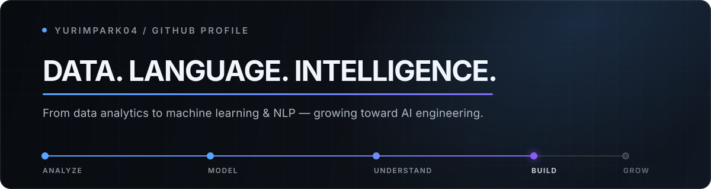
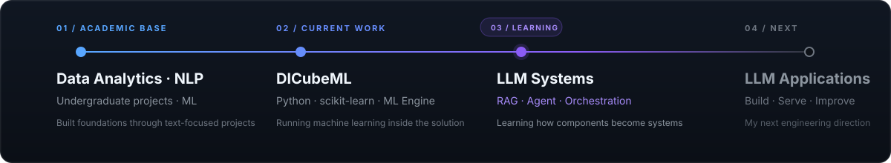
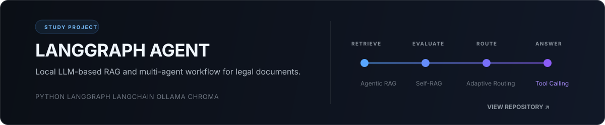

  

 

### `01 / PROFILE`

학부 시절 **NLP 프로젝트**를 중심으로 데이터 분석과 머신러닝을 공부했습니다. 
현재 **Python과 scikit-learn**을 기반으로 머신러닝 워크플로를 실행하는 **DICubeML 엔진**을 개발하고 있습니다.

데이터 분석·머신러닝 기반 위에서 현재는 **LLM·RAG·AI Agent**를 공부하며 **LLM Application Engineering** 영역으로 확장하고 있습니다.

 

 

### `02 / TOOLKIT`

**Current work** &nbsp; `DICubeML` `Python` `scikit-learn` `ML Engine` 
**Data** &nbsp; `SQL` `Pandas` `NumPy` `Jupyter` 
**Academic background** &nbsp; `Machine Learning` `NLP` `Text Analysis` 
**Visualization** &nbsp; `Matplotlib` `Seaborn` `Plotly` 
**Exploring now** &nbsp; `LangChain` `LangGraph` `RAG` `Chroma` `Ollama`

 

### `03 / SELECTED STUDY`

 

### `04 / ACTIVITY`

  
  

 

  LEARN WITH INTENT · BUILD WITH CONTEXT · GROW WITH CONSISTENCY

